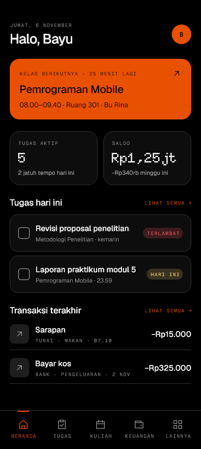
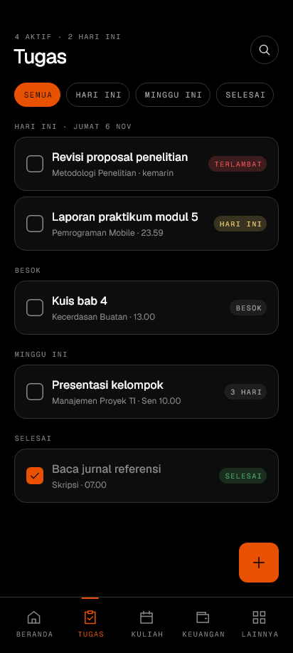
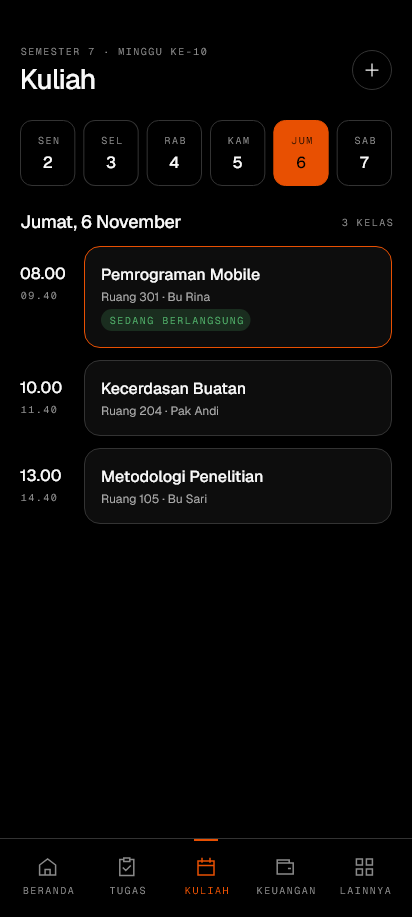
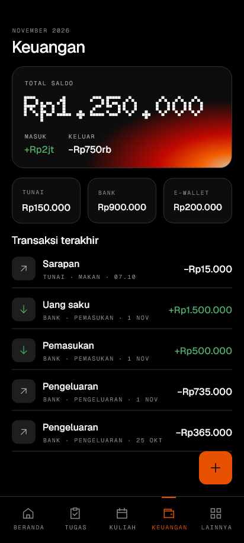

# Super App

**Kuliah, tugas, dan keuangan dalam satu app Android.**
Tetap jalan tanpa internet, tersinkron ke cloud saat online lagi.

**[⬇ Download APK](https://github.com/baymakeprojects/Super_App/releases/latest)**

## Tentang

Jadwal kuliah, tugas, dan uang saku biasanya tersebar di grup chat, kalender, catatan, dan ingatan. Super App menyatukannya dalam satu app, dengan satu pertanyaan utama: *apa yang harus aku kerjakan hari ini?*

App ini dibuat oleh Bayu dengan Flutter, sambil belajar Flutter. Tampilannya hanya mode gelap, dalam Bahasa Indonesia, dan tanpa fitur AI.

## Screenshot

<table>
  <tr>
    <td align="center"> Beranda</td>
    <td align="center"> Tugas</td>
    <td align="center"> Kuliah</td>
  </tr>
  <tr>
    <td align="center"> Keuangan</td>
    <td align="center"> Masuk dengan email</td>
    <td align="center"> Kunci sidik jari</td>
  </tr>
</table>

Screenshot memakai data contoh.

## Fitur

- 🏠 **Beranda:** kelas berikutnya, tugas hari ini dan yang terlambat, total saldo, dan transaksi terakhir dalam satu layar.
- ✅ **Tugas:** deadline, mata kuliah, prioritas, sub-tugas, dan filter per deadline. Tugas yang lewat deadline ditandai merah, dan hapus atau tandai selesai bisa diurungkan.
- 🎓 **Kuliah:** jadwal mingguan per hari, mata kuliah dengan dosen dan ruang, serta detail mata kuliah beserta tugasnya.
- 💸 **Keuangan:** catat pemasukan dan pengeluaran dalam hitungan detik, dengan kategori dan dompet (tunai, bank, e-wallet). Saldo dan ringkasan bulan ini dihitung otomatis.
- ✉️ **Masuk tanpa password:** cukup email dan kode 6 digit yang dikirim ke email.
- 🔒 **Kunci sidik jari:** app meminta sidik jari setiap dibuka, dengan PIN cadangan.
- 📶 **Tetap jalan offline:** semua catatan disimpan dulu di HP, lalu tersinkron otomatis saat internet kembali.

## Download & pasang

1. Buka **[halaman Releases](https://github.com/baymakeprojects/Super_App/releases/latest)** dari HP Android, lalu unduh `super-app-vX.Y.Z.apk` di bagian **Assets**.
2. Ketuk file yang sudah diunduh.
3. Kalau muncul pesan bahwa HP tidak diizinkan menginstal aplikasi tidak dikenal, ketuk **Setelan**, aktifkan **Izinkan dari sumber ini** untuk browser atau app File, lalu kembali.
4. Ketuk **Instal**. Kalau Google Play Protect memberi peringatan, pilih **Detail lainnya → Tetap instal**.
5. Setelah terpasang, matikan lagi **Izinkan dari sumber ini**.

Nama menu bisa sedikit berbeda di tiap merek HP; cari *"instal aplikasi tidak dikenal"* di Setelan.

**Update:** pasang APK versi baru di atas versi lama; datamu tidak hilang. Selalu ambil APK dari halaman Releases ini, karena APK dari tempat lain tidak bisa dipasang di atas versi resmi.

> Sejak September 2026, Android di Indonesia mewajibkan [verifikasi developer](https://support.google.com/android-developer-console/answer/16561738) untuk app di luar Play Store. Kalau HP menolak memasang APK, kemungkinan verifikasi itu belum selesai.

## Dibangun dengan

Flutter dan Dart · Supabase · SQLite (drift) · Riverpod · go_router

## Status

Super App masih dalam pengembangan (versi 0.x). Modul Tugas, Kuliah, Keuangan, Beranda, login, kunci sidik jari, dan sinkron offline sudah jadi. Yang sedang dikerjakan: setup awal, pengaturan, dan APK pertama.

Setelah itu rencananya versi Windows, notifikasi, kebiasaan, catatan, dan kalender.

Menemukan bug atau punya saran? Buat **[Issue](https://github.com/baymakeprojects/Super_App/issues)** dengan langkah mengulang dan screenshot.

## Lisensi

[MIT](LICENSE) © 2026 Bayu
