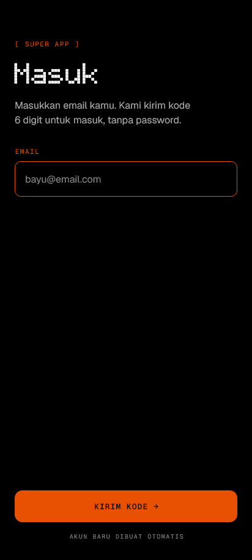
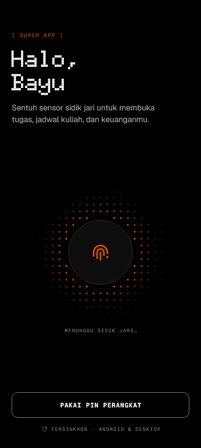

# Super App

App Android pribadi untuk mengatur **kuliah, tugas, dan keuangan** dalam satu tempat. Tetap jalan tanpa internet, dan datanya tersinkron ke cloud saat online lagi.

Dibuat dengan Flutter oleh Bayu, mahasiswa Informatika, sambil belajar Flutter. Android dulu; versi Windows menyusul di Tahap 2.

> **Status:** sedang dikembangkan (versi 0.x). Fase 1–3 MVP sudah selesai; Fase 4 (setup awal, pengaturan, dan rilis APK pertama) sedang dikerjakan. Lihat [Status pengembangan](#status-pengembangan).

## Screenshot

<table>
  <tr>
    <td align="center"><br>Beranda</td>
    <td align="center"><br>Tugas</td>
    <td align="center"><br>Kuliah</td>
  </tr>
  <tr>
    <td align="center"><br>Keuangan</td>
    <td align="center"><br>Masuk dengan email</td>
    <td align="center"><br>Kunci sidik jari</td>
  </tr>
</table>

Gambar di atas diambil dari golden test (`flutter test`) dengan data contoh, jadi selalu sama dengan tampilan app terbaru.

## Fitur (MVP)

- **Beranda:** kelas berikutnya, tugas hari ini dan yang terlambat, total saldo, dan transaksi terakhir dalam satu layar.
- **Tugas:** tambah, ubah, hapus, tandai selesai, sub-tugas, prioritas, mata kuliah, dan filter per deadline. Tugas lewat deadline ditandai merah. Hapus dan tandai selesai bisa diurungkan.
- **Kuliah:** semester, jadwal mingguan per hari, mata kuliah dengan dosen dan ruang, serta detail mata kuliah beserta tugasnya.
- **Keuangan:** catat pemasukan dan pengeluaran dalam hitungan detik, kategori, dompet (tunai, bank, e-wallet) dengan saldo otomatis, dan ringkasan bulan ini.
- **Login email + kode:** masuk dengan email dan kode 6 digit yang dikirim ke email, tanpa password.
- **Kunci sidik jari:** app meminta sidik jari setiap dibuka, dengan PIN cadangan.
- **Offline-first:** semua catatan disimpan dulu di HP, jadi app tetap bisa dipakai tanpa internet. Saat online lagi, perubahan terkirim otomatis ke Supabase. Banner offline dan tombol Coba lagi muncul kalau sinkron gagal.

Hanya mode gelap, berbahasa Indonesia, dan tanpa fitur AI.

## Download APK

APK terbaru ada di halaman **[Releases](https://github.com/baymakeprojects/Super_App/releases/latest)**. Buka rilis teratas, lalu unduh file `super-app-vX.Y.Z.apk` di bagian **Assets**.

> Rilis pertama yang siap dipakai akan muncul setelah tugas W4-08 selesai (proyek Supabase prod dan keystore). Sebelum itu halaman Releases mungkin masih kosong.

### Cara memasang di HP Android

1. Buka link Releases di atas **dari HP**, lalu unduh file `.apk`.
2. Ketuk file yang sudah diunduh (dari notifikasi unduhan atau app **File**).
3. Kalau muncul pesan *"Untuk keamanan, ponsel Anda tidak diizinkan menginstal aplikasi tidak dikenal dari sumber ini"*, ketuk **Setelan**, aktifkan **Izinkan dari sumber ini** untuk browser atau app File yang kamu pakai, lalu kembali.
4. Ketuk **Instal**. Kalau Google Play Protect menampilkan peringatan untuk app yang belum dikenal, pilih **Detail lainnya → Tetap instal**.
5. Setelah terpasang, matikan lagi **Izinkan dari sumber ini** supaya HP tetap aman.

Nama menu bisa sedikit berbeda di tiap merek HP; cari kata kunci *"sumber tidak dikenal"* atau *"instal aplikasi tidak dikenal"* di Setelan.

**Update:** unduh APK versi baru dan pasang di atas versi lama; data tidak hilang. Update hanya bisa dipasang kalau APK ditandatangani dengan kunci yang sama, jadi selalu ambil APK dari halaman Releases ini.

**Catatan:** sejak September 2026, Android di Indonesia mewajibkan [verifikasi developer](https://support.google.com/android-developer-console/answer/16561738) untuk app yang dipasang di perangkat bersertifikat. Kalau HP menolak memasang APK, kemungkinan verifikasi developer belum selesai.

## Teknologi

| Bagian | Yang dipakai |
| --- | --- |
| Framework | Flutter 3.50 (Dart 3.14), Android dulu, Windows di Tahap 2 |
| State | flutter_riverpod |
| Navigasi | go_router |
| Database di HP | SQLite lewat drift (sumber data utama, offline-first) |
| Backend | Supabase: Postgres dengan Row Level Security, Auth (email + kode verifikasi) |
| Sinkron | Mesin sinkron sendiri: antrean perubahan lokal → Supabase, lalu tarik perubahan per tabel |
| Keamanan | local_auth (sidik jari), flutter_secure_storage (sesi terenkripsi) |
| Lainnya | intl (format Rp dan tanggal Indonesia), connectivity_plus, freezed, json_serializable |
| Desain | [Figma Super App](https://www.figma.com/design/kK09B05WOCxXSf5dvukX41), font Doto, Geist, dan Geist Mono |
| Uji | `flutter test` dengan golden test untuk komponen dan layar |

Struktur kode: `lib/features/<fitur>/{presentation,application,data}`. Layar tidak pernah memanggil Supabase langsung, selalu lewat repository. Rencana lengkap ada di folder [`docs/`](docs/), mulai dari [`docs/prd.md`](docs/prd.md) dan [`docs/spesifikasi-teknis.md`](docs/spesifikasi-teknis.md).

App hanya memegang **publishable key** Supabase. Kunci lain (service role, SMTP) dan keystore tidak pernah masuk app atau Git.

## Menjalankan dari kode

### Prasyarat

| Alat | Versi / catatan |
| --- | --- |
| Flutter SDK | 3.50 stable (Dart 3.14), dipasang di `C:\dev\flutter`; cek dengan `flutter doctor` |
| Android Studio | Untuk Android SDK dan emulator |
| VS Code | Ekstensi Flutter dan Dart |
| Git + akun GitHub | Repo [baymakeprojects/Super_App](https://github.com/baymakeprojects/Super_App) |
| Node.js | Untuk Supabase CLI lewat `npx supabase` |
| Akun Supabase | Proyek `superapp-dev` (paket gratis) |
| Claude Code | Dengan plugin Figma (lihat `START-HERE.md`) |

### Langkah pertama kali

1. **Ambil kode:** `git clone https://github.com/baymakeprojects/Super_App.git super_app` lalu `cd super_app`. Simpan di path tanpa spasi (misalnya `C:\dev\super_app`) supaya build native tidak bermasalah.
2. **Pasang paket:** `flutter pub get`.
3. **Buat kode turunan** (drift, freezed, json): `dart run build_runner build --delete-conflicting-outputs`.
4. **Siapkan Supabase dev:**
   - Buat proyek `superapp-dev` di dashboard Supabase.
   - Aktifkan login email dengan kode 6 digit dan ubah template emailnya (lihat [`docs/setup-supabase.md`](docs/setup-supabase.md) bagian 3).
   - Hubungkan repo: `npx supabase login`, lalu `npx supabase link --project-ref <ref-proyek>`.
   - Jalankan migrasi: `npx supabase db push`.
5. **Isi kunci lokal:** buat file `env/dev.json` (folder `env/` tidak masuk Git) dengan isi seperti ini, lalu ganti nilainya dengan URL dan publishable key dari Dashboard → Project Settings → API Keys:

   ```json
   {
     "SUPABASE_URL": "https://<ref-proyek>.supabase.co",
     "SUPABASE_PUBLISHABLE_KEY": "sb_publishable_..."
   }
   ```

6. **Jalankan app** di HP (USB debugging aktif) atau emulator:

   ```powershell
   flutter run --dart-define-from-file=env/dev.json
   ```

   Tanpa file env (`flutter run` biasa), login dan sinkron mati, dan build debug langsung membuka Beranda dengan akun sementara `dev-lokal`.

### Perintah sehari-hari

| Keperluan | Perintah |
| --- | --- |
| Jalankan app (dev) | `flutter run --dart-define-from-file=env/dev.json` |
| Format kode | `dart format .` |
| Cek kode | `flutter analyze` |
| Semua tes | `flutter test` |
| Perbarui golden test setelah perubahan desain yang disengaja | `flutter test --update-goldens` |
| Tes integrasi di HP | `flutter test integration_test` |
| Buat kode turunan saat tabel atau model berubah | `dart run build_runner build --delete-conflicting-outputs` |
| Migrasi database baru | `npx supabase migration new <nama>`, isi SQL-nya, lalu `npx supabase db push` |
| Build APK release di laptop | `flutter build apk --release --dart-define-from-file=env/prod.json` |

### Yang tidak boleh masuk Git

`env/`, `*.jks`, `*.keystore`, `android/key.properties`, `.dart_tool/`, `build/` (sudah ada di `.gitignore`).

Keystore release dan sandinya disimpan di luar repo dengan cadangan (misalnya pengelola sandi + Google Drive pribadi). Kalau hilang, update app tidak bisa dipasang di atas versi lama. Untuk build lewat GitHub Actions, keystore disimpan sebagai GitHub Secret (lihat [`docs/rilis.md`](docs/rilis.md)).

### Masalah yang sering muncul

| Gejala | Penyebab biasa | Solusi |
| --- | --- | --- |
| Kode verifikasi tidak masuk email | Layanan email bawaan Supabase hanya mengirim ke anggota tim proyek dan sangat dibatasi | Masuk dengan email akun Supabase kamu, atau pasang SMTP sendiri (lihat `docs/setup-supabase.md`) |
| Email berisi tautan, bukan kode | Template email belum memakai `{{ .Token }}` | Ubah template *Confirm signup* dan *Magic Link* sesuai `docs/setup-supabase.md` |
| App tidak bisa terhubung ke Supabase | Proyek dev dijeda setelah 7 hari tidak aktif | Buka dashboard Supabase dan lanjutkan proyeknya |
| Error tabel atau kolom tidak ditemukan | Migrasi belum dijalankan atau kode turunan basi | `npx supabase db push`, lalu `build_runner build` |
| Golden test gagal setelah mengubah komponen | Tampilan berubah | Cek dengan Figma dulu; kalau memang disengaja, jalankan `--update-goldens` |
| Font tampil berbeda | Font belum terdaftar di `pubspec.yaml` | Daftarkan Doto, Geist, dan Geist Mono di bagian `fonts` |
| HP menolak memasang APK baru di atas versi lama | APK ditandatangani dengan kunci berbeda | Pakai APK dari Releases, atau hapus versi lama dulu (data lokal yang belum tersinkron ikut hilang) |

## Rilis

APK dibangun otomatis oleh GitHub Actions setiap kali tag versi `v*` (misalnya `v0.4.0`) didorong ke GitHub, lalu dilampirkan ke halaman Releases. Langkah lengkap, daftar GitHub Secrets, dan template catatan rilis ada di [`docs/rilis.md`](docs/rilis.md).

## Status pengembangan

| Fase | Isi | Status |
| --- | --- | --- |
| 1 — Fondasi | Token tema dan komponen dari Figma, Supabase dev, database drift, login email + kode, sidik jari + PIN | Selesai |
| 2 — Tugas & Kuliah | Modul Tugas dan Kuliah, termasuk tampilan kosong dan isian belum lengkap | Selesai |
| 3 — Keuangan, Beranda, sinkron | Modul Keuangan, Beranda, sinkron offline, banner offline | Selesai |
| 4 — Pertama kali, rapikan, rilis | Setup awal, splash dan ikon app, Lainnya dan Pengaturan, uji, APK release pertama | Sedang dikerjakan |

Daftar tugas rinci ada di [`docs/backlog.md`](docs/backlog.md). Setelah MVP, rencananya: versi Windows, notifikasi, kebiasaan, catatan, kalender, dan lainnya (lihat [`docs/prd.md`](docs/prd.md)).

Menemukan bug? Buat [Issue](https://github.com/baymakeprojects/Super_App/issues) dengan langkah mengulang, hasil, harapan, dan screenshot.

## Lisensi

Kode Super App memakai lisensi [MIT](LICENSE). Font Doto, Geist, dan Geist Mono memakai SIL Open Font License (lihat `assets/fonts/`).
